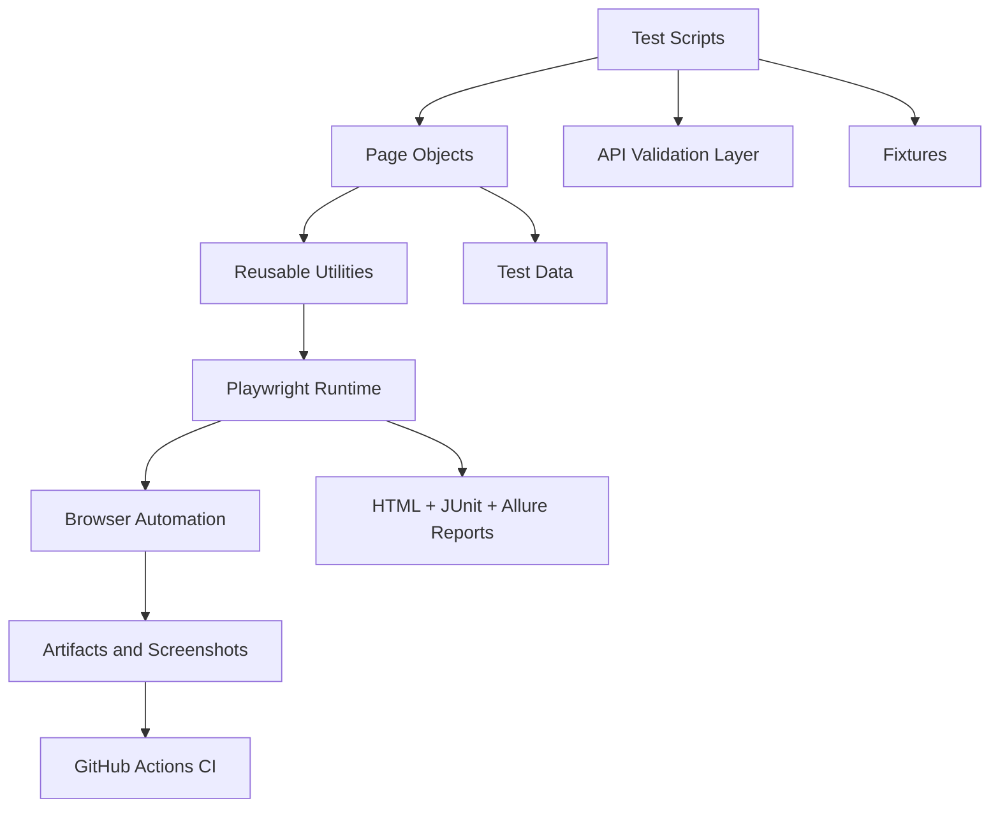

# AI-Powered Playwright Automation Framework

A professional, enterprise-ready Playwright + TypeScript automation framework designed for UI regression testing, API validation, and AI-assisted QA reporting. This project is built as a portfolio and freelance showcase to demonstrate advanced automation engineering capabilities for international clients.

## Project Overview

This repository is a production-minded Playwright + TypeScript automation framework built for portfolio and freelance use. It demonstrates how a QA automation engineer can create a maintainable, scalable, and business-focused test strategy using modern browser automation, API checks, CI pipelines, and AI-assisted debugging workflows.

The project targets the public SauceDemo application to validate core user journeys such as login, product discovery, cart actions, checkout, and logout. It is designed to communicate engineering quality to freelance clients, QA recruiters, and engineering managers who evaluate automation skill beyond simple test scripts.

## Architecture Diagram Description

The architecture follows a layered testing model where each layer has a clear accountability boundary:



This structure avoids mixing domain actions with test logic. Instead, the tests stay readable while the page objects encapsulate UI behavior, the utilities centralize configuration, and the reporting layer captures execution evidence.

## Framework Design Decisions

The framework is intentionally built around industry-standard patterns to maximize maintainability and readability:

- Page Object Model for page-specific actions and locators
- Reusable utility functions for environment and helper logic
- Centralized test data for credentials and expected values
- Separate API layer for response validation and contract checks
- Failure-oriented reporting with HTML, JUnit, and Allure outputs
- Stable locator strategy using data-test attributes where available
- CI-friendly execution that keeps local and remote runs consistent

## Technologies Used

- Playwright
- TypeScript
- Node.js
- GitHub Actions
- HTML reporting
- JUnit reporting
- Allure reporting
- GitHub for version control and collaboration
- VS Code for development

## Test Coverage

The project covers a representative set of high-value functional checks:

- Successful login
- Invalid login validation
- Product validation
- Add to cart flow
- Logout flow
- Purchase flow
- API status validation
- JSON response validation

This is intentionally designed to reflect common real-world regression risks in browser-based applications and backend integrations.

## CI/CD Workflow Explanation

The GitHub Actions workflow automates the validation pipeline by performing the following steps:

1. Checkout the repository
2. Set up Node.js
3. Install dependencies
4. Install Playwright browsers
5. Run the Playwright suite
6. Publish test artifacts and reports

This ensures the project remains reproducible in CI and provides evidence for each execution run. It also reduces manual test execution errors and keeps the project presentation-ready for recruiters and clients.

## AI-Assisted QA Capabilities

This framework includes AI-oriented QA practices that improve debugging and analysis without depending on external paid APIs:

- Failure analysis guidance based on Playwright artifacts
- Root-cause reasoning for selectors, timing issues, and API contract mismatches
- AI-style QA prompt library for debugging and bug triage
- Structured failure documentation for follow-up investigation

These capabilities are especially useful for teams aiming to reduce time-to-diagnosis while keeping the implementation offline and framework-friendly.

## Execution Examples

Run all tests:

```bash
npx playwright test
```

Run Chromium only:

```bash
npx playwright test --project=chromium
```

Run in headed mode:

```bash
npx playwright test --headed
```

Run with Allure reporting:

```bash
npm run test:allure
```

Open Playwright HTML report:

```bash
npx playwright show-report reports/html-report
```

Open Allure report:

```bash
npm run report:allure
```

## Screenshots

The framework automatically captures screenshots and videos for failures and stores test artifacts under the reports and screenshots directories. These artifacts are useful for debugging, issue review, and portfolio demonstration.

> Screenshots and report snapshots can be added to the repository documentation as visual proof of automation quality when preparing client-facing presentations.

## Future Roadmap

Planned improvements include:

- Allure enhancements and richer execution summaries
- Visual regression testing
- BDD/test-case management integration
- API schema validation expansion
- Database verification coverage
- Reporting dashboards for QA metrics and trends
- Deeper AI-assisted root cause analysis for flaky tests

## Core Features

- Page Object Model architecture
- TypeScript-based typed test suite
- Cross-browser execution: Chromium, Firefox, WebKit
- Retry and failure capturing for stability
- HTML reporting and JUnit reporting
- Screenshot and video capture on failure
- API validation with Playwright request context
- Data-driven user and product management
- GitHub Actions CI pipeline
- AI-assisted debugging and bug reporting documentation

## Project Structure

```text
ai-playwright-automation-framework/
├── .github/
│   └── workflows/
│       └── playwright.yml
├── api/
│   ├── demoApi.ts
│   └── sauceDemoApi.ts
├── fixtures/
│   └── fixtures.ts
├── pages/
│   ├── BasePage.ts
│   ├── CartPage.ts
│   ├── InventoryPage.ts
│   ├── LoginPage.ts
│   └── ...
├── reports/
├── screenshots/
├── test-data/
│   └── users.ts
├── tests/
│   ├── api.spec.ts
│   └── saucedemo.spec.ts
├── utils/
│   ├── env.ts
│   └── helpers.ts
├── .env.example
├── .gitignore
├── playwright.config.ts
├── package.json
├── tsconfig.json
├── README.md
└── LICENSE
```

## Installation

1. Clone the repository
2. Install dependencies:

```bash
npm install
```

3. Install Playwright browsers:

```bash
npx playwright install --with-deps chromium firefox webkit
```

4. Install Allure CLI (optional, for local report viewing):

```bash
npm install -D allure-playwright
```

If needed, install the Allure command-line tool globally:

```bash
npm install -g allure-commandline
```

## Execution Commands

Run all tests:

```bash
npx playwright test
```

Run Chromium only:

```bash
npx playwright test --project=chromium
```

Run tests in headed mode:

```bash
npx playwright test --headed
```

Run tests with Allure reporting:

```bash
npm run test:allure
```

Open HTML report:

```bash
npx playwright show-report reports/html-report
```

Open Allure report locally:

```bash
npm run report:allure
```

## Allure Reporting

This framework includes Allure integration alongside the existing HTML and JUnit reporters. Allure provides rich test result visualization, including:

- test history and trends
- step-level execution details
- screenshots and attachments
- failure traces and debug context
- execution summaries for QA reporting

## Test Scenarios Covered

- Successful login
- Invalid login validation
- Product validation
- Add to cart flow
- Logout flow
- API status validation
- JSON response validation

## AI-Assisted QA Features

The project includes AI-focused documentation for:

- AI-generated test scenario planning
- Failure analysis workflow
- AI-assisted bug report templates
- Debugging prompts for failed Playwright tests

See the docs in the documentation folder for examples and prompts.

## CI/CD

The GitHub Actions workflow runs on push, pull request, and manual dispatch. It:

- installs dependencies
- installs browsers
- executes Playwright tests
- publishes reports and artifacts

## Sample Test Report

The HTML report is stored under the reports directory and is generated by Playwright after execution.

## Future Enhancements

- Allure reporting integration
- Visual regression testing
- Cucumber BDD layer
- API schema validation
- Test case management integration
- Database validation checks
- AI-based root cause analysis automation

## Best Practices Used

- Clean naming conventions
- Modular page object design
- Centralized configuration
- Reusable utilities
- Stable selectors with test attributes
- Failure screenshot and video retention
- CI-friendly execution model

## Why This Framework is Portfolio-Ready

This is designed to feel like a real-world automation solution used by teams shipping reliable web and API coverage. It balances maintainability, clarity, and execution quality so it can be confidently showcased to clients and recruiters.
